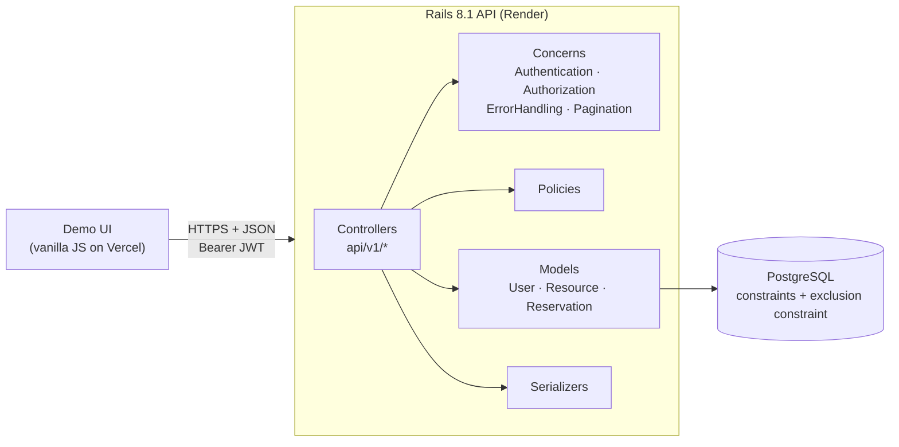
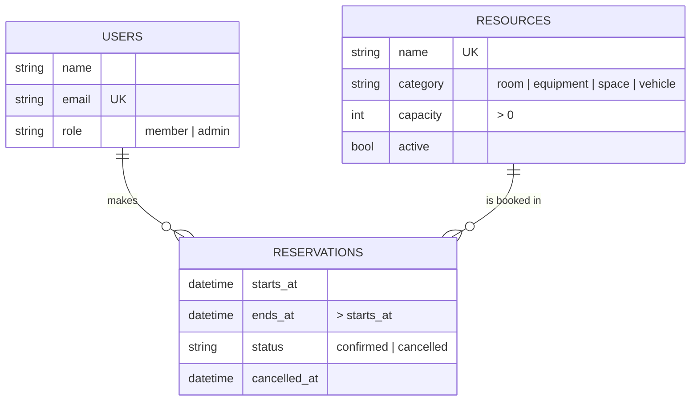
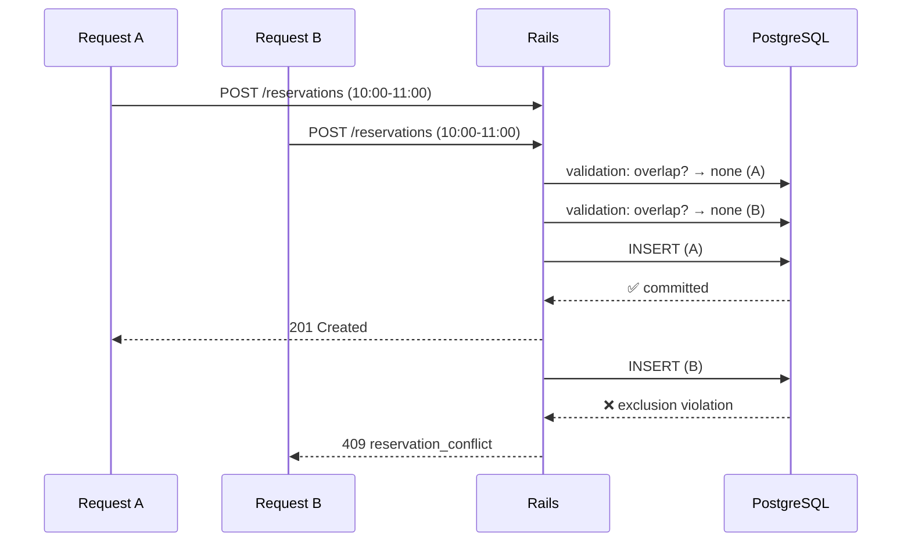
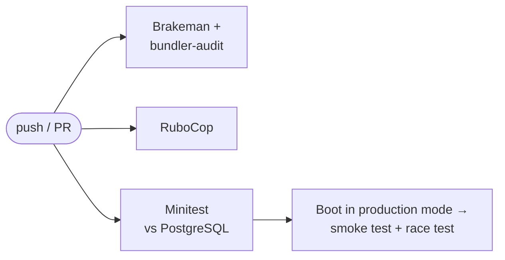

<div align="center">

# 🏘️ Community Resource Reservation API

**A production-style Ruby on Rails REST API for booking shared community resources:<br>rooms, equipment, garden plots, and vehicles.**

Built for the **Community of Guardians** project.

[](https://github.com/nishithata/community-reservations-api/actions/workflows/ci.yml)


[**Live demo**](#-live-demo) · [**Quick start**](#-quick-start) · [**API docs**](docs/API.md) · [**Architecture**](docs/ARCHITECTURE.md) · [**Deployment**](docs/DEPLOYMENT.md)

</div>

---

## ✨ Why this project

Booking systems look simple until two people click **Reserve** at the same moment. This API is built around getting that right. It combines friendly validation errors with a **PostgreSQL exclusion constraint** that makes double bookings impossible, even under concurrent requests. Around that core it adds the pieces a real service needs: authentication, role-based authorization, pagination, consistent errors, rate limiting, automated tests, CI/CD, and one-click deployment.

## 🚀 Live demo

| | |
|---|---|
| **Demo UI** (Vercel) | _coming soon_ |
| **API** (Render) | _coming soon_: try `/api/v1/health` |
| **Demo login** | `demo@example.com` / `demo-password-123` |

> The API runs on a free tier that sleeps when idle, so the first request can take 30-60 seconds while it wakes up.

## 🧩 Features

- **RESTful, versioned API** (`/api/v1`) with resource CRUD, reservations, availability, and precise status codes (`200 201 204 400 401 403 404 409 422 429`)
- **Double-booking protection** at two layers: an ActiveRecord validation for clear messages, and a database exclusion constraint for correctness under races
- **JWT authentication** with bcrypt password hashing; roles are always read from the database, never trusted from the token
- **Role-based authorization** with plain-Ruby policies: admins manage the catalog, members manage only their own bookings
- **Pagination and filtering** with Pagy (`page`, `per_page`, totals in `meta`), plus filters for category, search, status, resource, and time window
- **One JSON error format** with machine-readable codes and field-level details
- **Hardening:** rate limits, CORS allow-list, strong parameters, filtered logs, HTTPS in production, and no secrets in the repo
- **87 automated tests**, plus live end-to-end and concurrency race scripts
- **Ship-ready:** GitHub Actions CI, Dockerfile, Docker Compose, Render Blueprint, and a Vercel-hosted demo UI

## 🏗️ Architecture





## 🔒 How double bookings are prevented

A naive "check for overlaps, then insert" has a race window. Two requests can both see the slot as free and both insert. This API closes that window inside the database:

```sql
EXCLUDE USING gist (
  resource_id WITH =,
  tsrange(starts_at, ends_at, '[)') WITH &&
) WHERE (status = 'confirmed')
```

*For the same resource, no two confirmed time ranges may overlap.* The `'[)'` bounds allow back-to-back bookings, and the `WHERE` clause lets a cancelled booking free its slot without deleting history.



This is proven by a database-level model test, a request test with the model check disabled, and `script/race_test.rb`, which fires simultaneous HTTP requests at a live server and requires exactly one to win. CI runs it on every push.

## 🛠️ Tech stack

| Layer | Technology |
|---|---|
| Language & framework | Ruby 3.4, Rails 8.1 (API mode) |
| Database | PostgreSQL with `btree_gist`, ActiveRecord migrations, check and exclusion constraints |
| Auth | JWT (`jwt` gem), `has_secure_password` (bcrypt) |
| Pagination | Pagy |
| Testing | Minitest (model and request tests), end-to-end and race scripts |
| Quality & security | RuboCop (Rails Omakase), Brakeman, bundler-audit |
| CI/CD | GitHub Actions |
| Deployment | Docker, Render (API + PostgreSQL), Vercel (demo UI) |

## ⚡ Quick start

**Requirements:** Ruby 3.4 and PostgreSQL 14+.

```bash
git clone https://github.com/nishithata/community-reservations-api.git
cd community-reservations-api

bin/setup --skip-server   # install gems, create and migrate the database
bin/rails db:seed         # demo users, resources, and reservations
bin/rails server          # → http://localhost:3000
```

Start the demo UI in another terminal:

```bash
cd web && python3 -m http.server 8091   # → http://localhost:8091
```

<details>
<summary><b>Prefer Docker?</b></summary>

```bash
docker compose up --build                  # API + PostgreSQL on http://localhost:3000
docker compose exec api bin/rails db:seed
```
</details>

**Demo accounts (local):**

| Role | Email | Password |
|---|---|---|
| Member | `demo@example.com` | `demo-password-123` |
| Admin | `admin@example.com` | `admin-password-123` (production uses `DEMO_ADMIN_PASSWORD`) |

## 📡 API at a glance

| Method | Endpoint | Access | Purpose |
|---|---|---|---|
| `POST` | `/api/v1/auth/register` | public | Create a member account → token |
| `POST` | `/api/v1/auth/login` | public | Email + password → token |
| `GET` | `/api/v1/me` | user | Current user |
| `GET` | `/api/v1/resources` | public | List resources (filter, search, paginate) |
| `GET` | `/api/v1/resources/:id` | public | Resource details |
| `GET` | `/api/v1/resources/:id/availability?date=` | public | Booked slots for a day |
| `POST` `PATCH` `DELETE` | `/api/v1/resources(/:id)` | admin | Manage the catalog |
| `GET` | `/api/v1/reservations` | user | Own reservations (all, for admins) |
| `GET` | `/api/v1/reservations/:id` | owner / admin | Reservation details |
| `POST` | `/api/v1/reservations` | user | Book a slot |
| `PATCH` | `/api/v1/reservations/:id/cancel` | owner / admin | Cancel a booking |
| `GET` | `/api/v1/health` · `/up` | public | Health checks |

**Example: book a slot, then try to double-book it**

```bash
TOKEN=$(curl -s -X POST localhost:3000/api/v1/auth/login -H "Content-Type: application/json" \
  -d '{"email":"demo@example.com","password":"demo-password-123"}' \
  | ruby -rjson -e 'puts JSON.parse($stdin.read)["token"]')

curl -s -X POST localhost:3000/api/v1/reservations \
  -H "Authorization: Bearer $TOKEN" -H "Content-Type: application/json" \
  -d '{"reservation":{"resource_id":1,"starts_at":"2030-01-15T10:00:00Z","ends_at":"2030-01-15T11:00:00Z"}}'
# → 201 Created

# same request again:
# → 409 {"error":{"code":"reservation_conflict","message":"This time slot overlaps an existing reservation"}}
```

Every error has the same shape:

```json
{ "error": { "code": "validation_failed", "message": "Validation failed",
             "details": { "ends_at": ["Ends at must be after starts_at"] } } }
```

See **[docs/API.md](docs/API.md)** for every endpoint, parameter, and response.

## ✅ Testing

```bash
bin/rails test                                     # 87 model + request tests
bin/rubocop && bin/brakeman                        # style + security scan
ruby script/smoke_test.rb http://localhost:3000    # live end-to-end checks
ruby script/race_test.rb http://localhost:3000 10  # 10 simultaneous bookings → exactly 1 succeeds
```

| What's covered | How |
|---|---|
| Resource CRUD, reservation creation and cancellation, filtering, pagination | Request tests |
| Validation errors and field-level messages | Model + request tests |
| Missing, malformed, expired, and forged tokens | Request tests |
| Authorization boundaries (403 vs 404) | Request tests |
| Database constraints on their own | Model tests that bypass validation |
| Concurrent double-booking | Request test + live race script |

**CI pipeline** (GitHub Actions, on every push and pull request):



## 📁 Project structure

```
app/
├── controllers/api/v1/    auth · resources · reservations · health
├── controllers/concerns/  authentication · authorization · error_handling · pagination
├── models/                user · resource · reservation
├── policies/              resource_policy · reservation_policy
├── serializers/           explicit JSON shapes
└── services/              json_web_token
db/migrate/                schema, constraints, exclusion constraint
test/models/               model + database-constraint tests
test/integration/api/v1/   API request tests
script/                    smoke_test.rb · race_test.rb
web/                       static demo UI (Vercel)
docs/                      API reference · architecture · deployment
```

## ☁️ Deployment

- **API → Render:** New → Blueprint → select this repo. `render.yaml` provisions PostgreSQL and the web service, generates secrets, runs migrations, and seeds demo data.
- **UI → Vercel:** import the repo with **Root Directory** set to `web`. No build step is needed.

Step-by-step instructions and a demo safety checklist are in **[docs/DEPLOYMENT.md](docs/DEPLOYMENT.md)**.

## 🗺️ Roadmap

- [ ] Refresh tokens and token revocation
- [ ] Recurring reservations and opening hours per resource
- [ ] OpenAPI spec generated from request tests
- [ ] Email confirmations and reminders via Active Job
- [ ] Keyset pagination for large catalogs

## 👩‍💻 Author

**Nishitha Thatha Anil:** [GitHub](https://github.com/nishithata) · [LinkedIn](https://www.linkedin.com/in/nishitha-anil/)

Released under the [MIT License](LICENSE).
